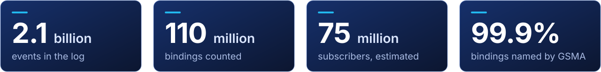
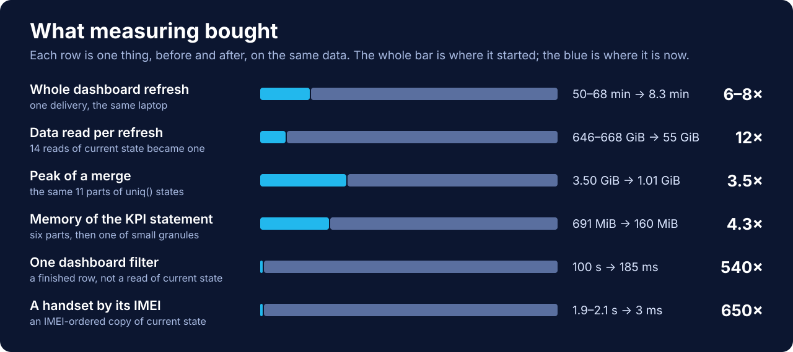
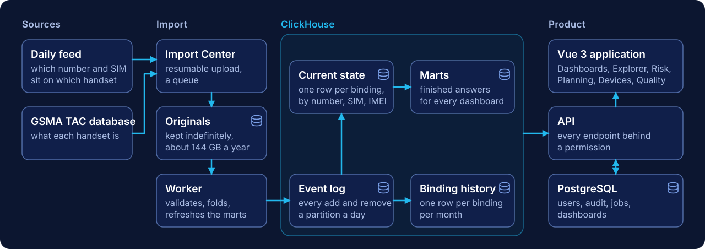

<div align="center">




[What it does](#what-it-does) &nbsp;·&nbsp; [The numbers](#the-numbers) &nbsp;·&nbsp; [How it works](#how-it-works) &nbsp;·&nbsp; [Five things first](#five-things-to-understand-first) &nbsp;·&nbsp; [Run it](#run-it) &nbsp;·&nbsp; [Deploying](#deploying) &nbsp;·&nbsp; [The documents](#the-documents)

</div>

Every day the operator's quality system (SNQM) reports which **handset** each **SIM** and **phone number**
is bound to. Quadrasense takes that feed, enriches it with the GSMA TAC device database, and keeps the
record of what is true: what a number, a SIM or a handset is bound to now, what it was bound to before,
and when that changed.

Among the operator's SIM and eSIM systems it is the **Primary Inventory (PI)**.
[The estate landscape](docs/architecture/20-estate-landscape.md) covers the systems around it, what each
one owns, and which of PI's responsibilities are built.



> **Status.** In use on the laptop against the full history, and running on its first server, the
> department's VM, with every day to 2026-10-31. Each merge to `main` deploys there. Next is MCI's
> OpenShift.

## What it does

<table>
<tr>
<td width="50%" valign="top">

#### Dashboards

The active population by manufacturer, model, OS and device type, and how it moves: which brands grow,
which lose bindings, which models are new. People build their own from widgets, and one filter answers
in 65 ms.

[The builder](docs/architecture/17-dashboard-builder.md) · [ADR-017](docs/adr/ADR-017-filtered-dashboard-views.md)

</td>
<td width="50%" valign="top">

#### Explorer

Look up a number, a SIM, an ICCID or a handset: what it is bound to, what it was bound to, and when.
Advanced mode compiles an allow-listed query to SQL, plans it, and runs it within a budget of rows and
time.

[Explorer modes](docs/architecture/18-explorer-modes.md) · [ADR-012](docs/adr/ADR-012-explorer-query-engine.md)

</td>
</tr>
<tr>
<td valign="top">

#### Import Center

Resumable uploads, a queue and a worker, validation, late days and revisions, versioned GSMA reference
data. A day folds into current state in seconds, and its original is kept for good.

[The import platform](docs/architecture/09-import-platform.md) · [ADR-018](docs/adr/ADR-018-resumable-uploads.md)

</td>
<td valign="top">

#### Risk signals

Levels, feed defects and SIM changes, against thresholds cut from curves of the real data. Without a
threshold the page says *not calibrated* rather than judge on an invented number.

[ADR-014](docs/adr/ADR-014-risk-signals.md) · [ADR-015](docs/adr/ADR-015-new-models-network-age-data-quality.md)

</td>
</tr>
<tr>
<td valign="top">

#### Network planning

Sunset exposure, eSIM readiness, radio bands, lifecycle and campaign lists. Each number is classed once
per delivery, in the worker's idle time, from parsed radio profiles.

[Network planning](docs/architecture/19-network-planning.md) · [ADR-019](docs/adr/ADR-019-planning-snapshot.md)

</td>
<td valign="top">

#### Devices

A catalogue where a model is a contiguous range of an IMEI-ordered table. Images are proposed, scored
from the pixels and approved by a person: nothing reaches the live table on its own.

[ADR-009](docs/adr/ADR-009-device-module.md) · [ADR-011](docs/adr/ADR-011-device-image-sourcing.md)

</td>
</tr>
<tr>
<td valign="top">

#### Data quality

What the feed gets wrong, measured per day. Rows with no handset stay stored, are shown here, and are
left out of every count.

[Feed quality](docs/architecture/15-feed-quality.md) · [ADR-020](docs/adr/ADR-020-rows-with-no-handset.md)

</td>
<td valign="top">

#### Identity and audit

Local sign-in, server-side sessions, permission-based RBAC, and an audit trail PostgreSQL itself keeps
append-only. A test enumerates the router to prove no endpoint escapes a permission.

[Identity and access](docs/architecture/12-identity-and-access.md) · [ADR-006](docs/adr/ADR-006-authentication-and-access-control.md)

</td>
</tr>
</table>

### The identifiers the name points at

| Identifier | What it is | In the feed |
|---|---|---|
| **MSISDN** | the number | yes |
| **IMSI** | the SIM | yes |
| **IMEI** | the handset | yes |
| **ICCID** | the SIM card | **derived, not delivered:** the operator's numbering builds it from the IMSI, so it can be searched too, and the UI and the exports say so ([the rule](docs/architecture/18-explorer-modes.md)) |
| **EID** | the eSIM chip | no, and nothing here pretends otherwise ([what the source delivers](docs/architecture/03-data-model.md)) |

## The numbers

Measured on the laptop, which holds the whole history, on 2026-11-06.

| Measure | Value |
|---|---:|
| Initial dump | **125,939,523** bindings (4.86 GiB, 2025-12-27 → 2026-01-25) |
| Daily change history | **2,139,460,693** events over **268 days** (2026-01-26 → 2026-10-31) |
| Days absent from the files received | **11** (7 in May, 3 in July, 1 in August) |
| Daily volume | 6.3M – 11.3M events a day (5th–95th percentile; median 7.7M) |
| Active rows | **116,124,016** |
| Bindings counted | **110,459,865**: 74,960,816 subscribers, 76,282,821 SIMs, 81,891,587 handsets (estimated) |
| Rows with no handset | **5,664,151**, stored and left out of every count |
| Device reference data | 271,830 TACs (GSMA version v2026.10.04, activated 2026-10-05) |
| TAC enrichment coverage | **99.89%** of bindings counted |

<div align="center">

</div>

<details>
<summary>The same figures as a table, and where each one comes from</summary>

<br>

| Measure | Before | After | Source |
|---|---:|---:|---|
| Whole dashboard refresh | 50–68 min | 499 s | [Worker capacity](docs/research/2026-11-worker-capacity.md) |
| Data read per refresh | 646–668 GiB | 55 GiB | [Worker capacity](docs/research/2026-11-worker-capacity.md) |
| Peak of a merge, the same 11 parts | 3.50 GiB | 1.01 GiB | [ClickHouse memory](docs/architecture/11-clickhouse-memory.md), §8 |
| Memory of the KPI statement | 691 MiB | 160 MiB | [ClickHouse memory](docs/architecture/11-clickhouse-memory.md), §8 |
| One dashboard filter | 100 s | 65 ms in the store, 82–185 ms in the browser | [ADR-017](docs/adr/ADR-017-filtered-dashboard-views.md) |
| A handset by its IMEI | 1,861–2,085 ms | 3 ms | [ADR-009](docs/adr/ADR-009-device-module.md) |

The refresh figures are the laptop's. The department VM's come with its next import.

</details>

## How it works



- **An immutable event log.** Each day's file is one partition, known by its SHA-256, so importing a day
  again replaces that day and nothing else.
- **State is a fold.** Current state comes from the log one day at a time, which the feed's own semantics
  make correct (see [the second thing](#five-things-to-understand-first) below).
- **Dashboards read finished answers.** They read only a delivery listed in `sqm.mart_ready`, which the
  refresh writes after every statement has succeeded. During a rebuild they serve the previous complete
  delivery and say so.
- **Lookups are key reads.** Copies of current state ordered by IMSI and by IMEI, and a binding history
  with one row per binding per month, make one entity a contiguous range rather than a scan.
- **Background work follows the machine.** Risk and Planning run side by side when ClickHouse reports the
  room for it, read at run time from its memory limit, its cores and the heaviest step it has seen: 1.55 to
  1.69 times the work of one lane, measured, and nothing runs beside an import.
- **Everything can be rebuilt.** The originals are kept indefinitely, about 144 GB a year, and every table
  comes back from them and the pipeline.

## Five things to understand first

**1. The grain is a *binding*, not a subscriber.**
`(msisdn, imsi, imei)`: a phone number, a SIM and a handset. Zero duplicates across 125.9M rows, so it is
a genuine natural key. 51.3% of numbers were seen on more than one handset, so "one row per subscriber"
is not a shape this data has. Every count in the product therefore states its unit: Samsung is 49,752,774 **bindings**, 37,891,404
**subscribers** or 36,342,722 **handsets**, the last two estimated, and all
three are correct answers to different questions.

**2. The feed has set semantics, and that is load-bearing.**
`add` and `remove` toggle a binding, and its final state depends only on its **last** event, not on the
path taken to it: verified over 8,062,257 transitions with **zero** repeated adds. That is what lets a
daily import fold only its own day into current state instead of replaying the whole event log. Measured:
the full replay takes about **45 minutes**, one day takes **seconds**. Without the proof, the 45-minute
path would be the only correct one.

**3. The dates were recovered, and two earlier conclusions were wrong.**
The original 82 files carried no dates, which was the project's largest open risk. The source then began
supplying dated filenames, and all 82 old files matched dated ones by exact byte size with **zero
unmatched**. The inferred ordering turned out to be exactly right, but the *span* was wrong (2026-01-26 →
2026-04-17, not 2026-02-23 → 2026-05-16), and the supposed gap did not exist. See
[the dated daily files](docs/discovery/03-dated-daily-files.md).

**4. Dashboards cannot be served from raw data, by either engine.**
The Phase 0 benchmark measured 3.5 s for a dashboard-shaped query against a 500 ms budget. The mart layer
is therefore **load-bearing architecture, not an optimisation**: see
[ADR-003](docs/adr/ADR-003-analytics-store.md).

**5. A row with no handset is not a binding.**
An IMEI of `000000`, one that is not 14 digits, or 14 digits no handset could carry is stored, and shown
only on Data quality and in Explorer when the search or the query names an IMEI or a TAC. It is left out of
every count. Measured: 99.9% of the `000000` rows are leftovers of the January dump, on SIMs with a real
handset. A TAC merely missing from the catalogue is a handset, and stays. See
[ADR-020](docs/adr/ADR-020-rows-with-no-handset.md).

## Run it

Docker, the .NET SDK that `global.json` pins, and Node:

```bash
docker compose -f infra/docker-compose.yml up -d   # ClickHouse :18123, PostgreSQL :15432
cp .env.example .env                               # every variable the stack reads

dotnet run --project backend/src/Sqm.Migrator -- --target postgres   --dir db/operational/migrations
dotnet run --project backend/src/Sqm.Migrator -- --target clickhouse --dir db/analytics/migrations

dotnet run --project backend/src/Sqm.Api --launch-profile http   # API :5202, worker inside
cd frontend && npm install && npm run dev                        # UI :5173
```

Before the first sign-in come the grants, the seed and the first administrator.
**[Running the system](docs/operations/running-the-system.md)** has those steps, every batch command, and
how the tests behave.

```bash
dotnet test backend/Sqm.slnx    # 929: Domain 243, Ingestion 165, Application 105, Integration 416
cd frontend && npm test         # 265, in 37 files
```

Integration tests run against a real PostgreSQL and ClickHouse, connected as the least-privileged
application role. With neither reachable they skip with a reason, so a green run without the stack proves
only what does not need it.

## Deploying

The system ships as containers ([ADR-007](docs/adr/ADR-007-deployment.md)) that run the way OpenShift runs
them: an arbitrary non-root UID in group 0, a read-only root filesystem, no capabilities, no port below
1024. ClickHouse, PostgreSQL, the API, the worker on its own and the web front, with the migrations and
grants as jobs that run on every start and do nothing when nothing changed.

| Stage | Where | State |
|---|---|---|
| **1** | the department's VM | running since 2026-10-24, every day to 2026-10-31 |
| **2** | MCI's OpenShift: dev, uat, prd | planned |

**How a change reaches a server:**

1. **Through a pull request.** Work is done on a branch and merged into `main` on GitHub, and the branch is
   deleted: `main` is the only branch that lasts.
2. **Pushed to the department's GitLab.** Over HTTPS from the development machine after each merge. The
   red lines let developers push and servers only pull, so no server pushes to another.
3. **The push deploys.** The pipeline tests, builds the four images with kaniko and deploys them to the VM.
   `deploy/compose/update.sh` remains the way to do it by hand.

[`docs/operations/deployment/`](docs/operations/deployment/) has the rest. The MCI documents behind it are
internal: this repository cites them by section and copies nothing identifying out of them.

## How it is built

**Prove it, never assert it.** Every performance claim here is backed by a real run on the real dataset.
Before a fix is called a fix, the bug goes back in and a test has to fail: the TAC scanner's 13 unit tests
once all passed against a version that silently dropped 62% of the file.

**The simplest thing that meets the current need.** Not the most extensible, not the most impressive. When
a simpler option was rejected, the ADR says why.

**Honest about state.** Conclusions that turned out wrong are marked SUPERSEDED and kept, not deleted.
Distinct counts are labelled *estimated*, because they are.

**Laptop now, dedicated hardware later.** The whole stack runs inside hard limits on a laptop. Every setting
chosen because of that is [listed](docs/operations/dedicated-hardware.md), to revisit on real hardware.

## The documents

| Start with | For |
|---|---|
| [Glossary](docs/architecture/02-glossary.md) | binding, fold, mart, delivery: the vocabulary the code uses |
| [Overview](docs/architecture/01-overview.md) | requirements, diagrams, risk register |
| [Data model](docs/architecture/03-data-model.md) | entities, tables, quality rules |
| [Data profiling report](docs/discovery/01-data-profiling-report.md) | what the data actually is, measured |
| [Running the system](docs/operations/running-the-system.md) | setup, every batch command, the tests |
| [Deployment](docs/operations/deployment/) | the containers, the department VM, MCI's OpenShift, the red lines, CI/CD |
| [Backlog](docs/backlog.md) | suggestions not built yet, with their evidence and cost |

<details>
<summary><b>Architecture decisions</b>: twenty-one ADRs, each with the evidence in it</summary>

<br>

| ADR | Decision | Status |
|---|---|---|
| [ADR-001](docs/adr/ADR-001-backend-technology.md) | Backend: **.NET 10 / C#** | Accepted |
| [ADR-002](docs/adr/ADR-002-operational-database.md) | Operational store: **PostgreSQL 17** | Proposed |
| [ADR-003](docs/adr/ADR-003-analytics-store.md) | Analytics store: **ClickHouse**: 26–35× on dashboard shapes, 3.4× smaller | Accepted |
| [ADR-004](docs/adr/ADR-004-ingestion-strategy.md) | Ingestion: immutable event log, SHA-256 idempotency, TAC joined at query time | Accepted |
| [ADR-005](docs/adr/ADR-005-frontend-architecture.md) | Frontend: **Vue 3** + Vite + Tailwind + headless primitives | Accepted |
| [ADR-006](docs/adr/ADR-006-authentication-and-access-control.md) | Auth: **local accounts, server-side sessions, permission-based RBAC** | Accepted |
| [ADR-007](docs/adr/ADR-007-deployment.md) | Deployment: **containers that run as OpenShift runs them** (non-root, any UID, read-only); the worker on its own; compose on the VM, then OpenShift | Proposed; stage 1 running |
| [ADR-008](docs/adr/ADR-008-imsi-search.md) | IMSI search: a second table ordered by IMSI, and a skip index on the event log | Accepted |
| [ADR-009](docs/adr/ADR-009-device-module.md) | Devices: a model is a TAC, and an IMEI-ordered table makes it a range | Accepted |
| [ADR-010](docs/adr/ADR-010-device-images.md) | Device images: keyed by model, sourced from Commons under identity guards | Amended by ADR-011 |
| [ADR-011](docs/adr/ADR-011-device-image-sourcing.md) | Device images are proposed, scored from the pixels and reviewed, never auto-applied | Accepted |
| [ADR-012](docs/adr/ADR-012-explorer-query-engine.md) | Explorer queries: an allow-listed model compiled to SQL, planned, and run within a budget of rows and time | Accepted |
| [ADR-013](docs/adr/ADR-013-binding-history.md) | Timelines: a binding history, one row per binding per month, by number, SIM and IMEI | Accepted |
| [ADR-014](docs/adr/ADR-014-risk-signals.md) | Risk signals: levels, feed defects, SIM change; measures precomputed, verdicts judged when read, thresholds cut from the data | Accepted |
| [ADR-015](docs/adr/ADR-015-new-models-network-age-data-quality.md) | New models, network age and data-quality signals, from a per-model day table | Accepted |
| [ADR-016](docs/adr/ADR-016-dashboard-builder.md) | The dashboard builder: one JSONB definition per dashboard; each widget reads an endpoint that already exists, under its permission | Accepted |
| [ADR-017](docs/adr/ADR-017-filtered-dashboard-views.md) | Filtered dashboard views read per-model population marts, and abandoned reads are killed | Accepted |
| [ADR-018](docs/adr/ADR-018-resumable-uploads.md) | Uploads resume after a broken connection, with the tus protocol | Accepted |
| [ADR-019](docs/adr/ADR-019-planning-snapshot.md) | Network planning: each number classed once per delivery by an idle-time snapshot, from parsed radio profiles | Accepted |
| [ADR-020](docs/adr/ADR-020-rows-with-no-handset.md) | Rows with no handset stay stored and are left out of every count | Accepted |
| [ADR-021](docs/adr/ADR-021-idle-lanes.md) | The worker runs what does not conflict in lanes, as many as the engine reports room for, with a brake | Accepted |

Every one of these was decided against measurement on the real dataset, not on reputation. Where a claim
appears in these documents, the number behind it is there too.

</details>

<details>
<summary><b>Repository layout</b></summary>

<br>

```
docs/
  discovery/       Phase 0 - what the data actually is, measured
    01-data-profiling-report.md    full profiling results
    02-open-questions.md           questions + documented assumptions
    03-dated-daily-files.md        how the date risk was closed
    04-07                          handset changes from 2026-09-15, shifted and copied IMEIs, data-quality examples
  architecture/    how the system is built
    01-overview.md                 requirements, diagrams, risk register
    02-glossary.md                 binding, fold, mart, delivery - the vocabulary the code uses
    03-data-model.md               entities, tables, quality rules
    04-security-model.md           roles, controls, audit
    05-roadmap.md                  the phases and what each delivers
    07-testing-strategy.md         what is tested and why
    08-observability.md            how the system says whether an import did the right thing
    09-import-platform.md          the import platform, design and build
    11-clickhouse-memory.md        container memory: what went wrong and what the settings mean
    12-identity-and-access.md      how auth, RBAC and audit are built, and how to operate them
    13-dashboard-review.md         every dashboard figure checked against the store, and what was wrong
    14-relationship-explorer.md    number / SIM / handset links, and which one of them is inferred
    15-feed-quality.md             what the feed gets wrong, measured per day
    16-ui-design-system.md         tokens, components, and the conventions the layout review settled
    17-dashboard-builder.md        dashboards people build from widgets
    18-explorer-modes.md           the Explorer's Simple and Advanced modes, and the derived ICCID
    19-network-planning.md         network and product planning: sunset, eSIM, bands, lifecycle, campaign lists
    20-estate-landscape.md         the systems around Quadrasense, what each owns, and PI's role among them
  operations/
    running-the-system.md          the development setup, every batch command, the tests
    dedicated-hardware.md          every setting chosen because of the laptop, to revisit on real hardware
    deployment/                    the containers, the department VM, MCI's OpenShift, red lines, CI/CD
  adr/             Architecture Decision Records
  research/        feature research
  assets/readme/   the drawings on this page
  backlog.md       suggestions not built yet, with their evidence and cost
backend/
  src/Sqm.Domain          the binding fold and identifier rules
  src/Sqm.Application     abstractions, query shapes, import contracts
  src/Sqm.Infrastructure  ClickHouse and PostgreSQL implementations
  src/Sqm.Api            minimal-API endpoints
  src/Sqm.Ingestion      the import worker, and the batch commands
  src/Sqm.Migrator       forward-only schema migrator for both stores
frontend/          Vue 3 SPA: dashboards, Import Center, Explorer, devices, risk, planning, feed quality, users, roles, audit
db/
  analytics/       ClickHouse migrations, batch jobs and seeds
  operational/
    migrations/    PostgreSQL migrations
    grants/        the least-privilege role, and what makes the audit log append-only
    jobs/          the backfill of the pre-platform load
infra/             the development environment as a compose file
deploy/
  images/          the Dockerfiles: api, worker, migrator (one build) and web (SPA + nginx)
  compose/         the whole system as containers, run the way OpenShift runs them (ADR-007), and update.sh
  host/            one-time server setup: the deploy runner, Docker's data root
  ci/              the kaniko build the GitLab pipeline runs
.gitlab-ci.yml     the department's pipeline: test, build, deploy
tools/
  source_device_images.py        proposes device images for review; never writes a live image
  import_device_image_package.py stages a curated image package as review candidates
  device_image_sources.json      the source allowlist, and why no manufacturer source is in it
  test_device_image_*.py         checks on identity, rejection, scoring, normalisation and packages
  repair_tac_transfer.py         rebuilds a TAC export damaged in transit, refusing if lossy
  quality_examples.py            the data-quality examples in docs/discovery/07
  cloud/setup.sh                 installs the pinned .NET SDK in a cloud session
  ops/                           laptop upkeep: shrinking Docker's data disk
  profiling/       reproducible data-profiling scripts (DuckDB)
  benchmark/       storage-engine benchmark harness
```

</details>

<br>

<div align="center">
<sub>Every figure on this page comes from a real run on the real dataset.</sub>
</div>
